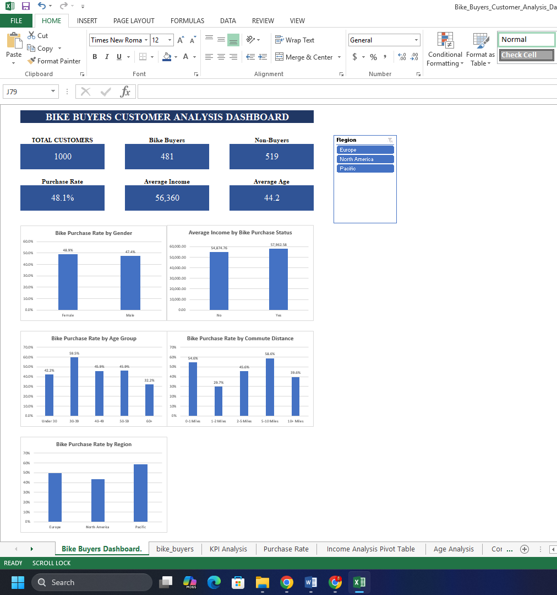

# Bike Buyers Customer Analysis Dashboard

**Tools:** Microsoft Excel | Pivot Tables | Slicers | Data Visualization

## Project Overview
Analyzed 1,000 customer records to identify factors associated with bicycle purchases and developed an interactive Excel dashboard to explore customer behavior across regions.

## Dashboard Preview

## Key Findings
- **48.1%** of customers purchased bicycles.
- Customers aged **30–39** had the highest age-group purchase rate (**59.5%**).
- Customers commuting **2–5 miles** recorded a **58.6%** purchase rate.
- **Pacific** had the highest regional purchase rate (**58.9%**).
- **North America** had the largest customer base (508) but the lowest regional purchase rate (**43.3%**).

## Business Recommendations
- Test targeted campaigns for customers aged 30–39.
- Introduce commuter bundles for customers traveling 0–5 miles.
- Investigate conversion barriers in North America.

## Project Files
- [Interactive Excel Dashboard](Bike_Buyers_Customer_Analysis_Dashboard.xlsx)
- [Full Project Case Study](Bike_Buyers_Customer_Analysis_Case_Study.pdf)

**Skills Demonstrated:** Data Cleaning, Pivot Tables, Excel Formulas, Interactive Dashboards, Customer Segmentation, and Business Analysis.
